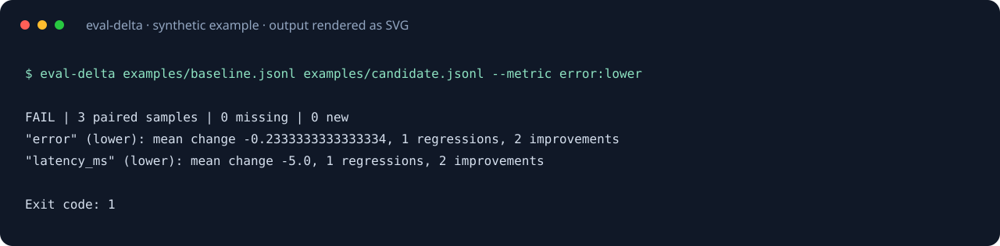

# Eval Delta

Find the regressions your average score hides.

[](https://github.com/Yang1107-wzy/eval-delta/actions/workflows/ci.yml)

[](LICENSE)

[中文说明](README.zh-CN.md) · [Releases](https://github.com/Yang1107-wzy/eval-delta/releases) · [Contributing](CONTRIBUTING.md)



Compare two completed evaluation runs by sample ID. Choose whether each numeric metric should go up or down, then get paired means, per-sample regression counts, missing samples and a CI-friendly exit code. No model calls, API keys, pandas or dashboard server.

## Install

Python 3.10+; no runtime dependencies. The project is distributed on GitHub, not PyPI.

```sh
python -m pip install "git+https://github.com/Yang1107-wzy/eval-delta.git@v1.0.0"
eval-delta --version
```

Alternatively download the wheel from [Releases](https://github.com/Yang1107-wzy/eval-delta/releases) and run `python -m pip install path/to/downloaded.whl` with its actual filename.

To run the bundled examples:

```sh
git clone https://github.com/Yang1107-wzy/eval-delta.git
cd eval-delta
python -m pip install .
```

## Try it

```sh
eval-delta examples/baseline.jsonl examples/candidate.jsonl --metric error:lower --metric latency_ms:lower
eval-delta examples/baseline.jsonl examples/improved.jsonl --metric error:lower --format json
eval-delta examples/baseline.jsonl examples/candidate.jsonl --metric error:lower --format markdown > comparison.md
```

The first comparison fails: the average error improves, but `sample-b` gets worse. The second comparison passes. File order does not matter.

## Input contract

One JSON object per line; `.gz` input also works:

```json
{"id": "sample-a", "error": 4.0, "latency_ms": 100}
{"id": "sample-b", "error": 2.0, "latency_ms": 80}
```

IDs are unique nonempty strings or integers. Numeric ID `1` and string ID `"1"` are distinct; booleans are invalid. Set `--id-key case_id` for a different ID field. Every row in both runs must contain finite numeric values for all requested metrics; strings, booleans, duplicate properties, missing metrics, blank lines and invalid JSON fail with exit 2. Decimal literals must round-trip through a Python float without losing decimal digits; underflow such as `1e-400` and excessively precise literals are rejected rather than silently changing evaluation outcomes.

Metric names are top-level keys. Repeat `--metric NAME:lower` or `NAME:higher`. Duplicate metric declarations are rejected.

## Regression policy

For lower-is-better metrics, `candidate - baseline > tolerance` is a regression. Higher-is-better reverses the sign. Changes with absolute magnitude at most tolerance are unchanged. Tolerance defaults to zero and is an **absolute per-sample** threshold in the units of every selected metric; use separate invocations if metrics need different tolerances.

```sh
eval-delta baseline.jsonl candidate.jsonl --metric accuracy:higher --tolerance 0.005
```

A comparison passes only when ID sets match, at least one sample pairs, and **no sample regresses** on any selected metric. Missing or new IDs fail even when the overlapping rows improve. Means are computed on paired rows only. Aggregate improvement does not cancel an individual regression. This is a deterministic regression gate, not a statistical significance test or a model-quality certification.

## Reports and automation

```sh
eval-delta baseline.jsonl candidate.jsonl --metric error:lower --format json > delta.json
```

JSON `schema_version: 1` includes `paired`, run sizes, missing/new ID lists, `tolerance`, `metrics`, `details` and `passed`. Each metric reports direction, paired means, mean change, regression/improvement/unchanged counts. `--max-details 100` caps the regression detail sample across metrics; summaries still cover every row. This sample is deterministic by metric argument order and sorted encoded IDs; it is not ranked by severity. A run with no pairs has null means.

Markdown output fits a GitHub Actions job summary:

```yaml
- name: Gate evaluation regressions
  shell: bash
  run: eval-delta baseline.jsonl candidate.jsonl --metric error:lower --format markdown > delta.md
- name: Show comparison
  if: always()
  shell: bash
  run: cat delta.md >> "$GITHUB_STEP_SUMMARY"
```

| Exit | Meaning |
| --- | --- |
| 0 | Comparison passed |
| 1 | Regression, changed ID set or zero paired samples |
| 2 | Usage, I/O or invalid data |

## Scope and limitations

Loads both runs into memory. Intended for small-to-medium evaluation sets, not a billion-row analytics engine. Per-sample classification uses exact rational differences of the accepted numeric representations; reported differences and means use floats; overflowed differences/means are rejected. It does not check dataset provenance, matching evaluation protocols, confidence intervals, nested metrics, provider APIs or whether run contents are trustworthy. The tool leaves both input files unchanged and writes reports to stdout only.

For executing and managing broader model evaluations, see [Promptfoo](https://github.com/promptfoo/promptfoo). Eval Delta is an independent lightweight comparison utility, not a replacement for that platform.

## Development

```sh
python -m pip install -e .
python -m unittest discover -s tests -v
```

CI runs on Linux, Windows and macOS. All examples use synthetic metrics. [MIT license](LICENSE).
